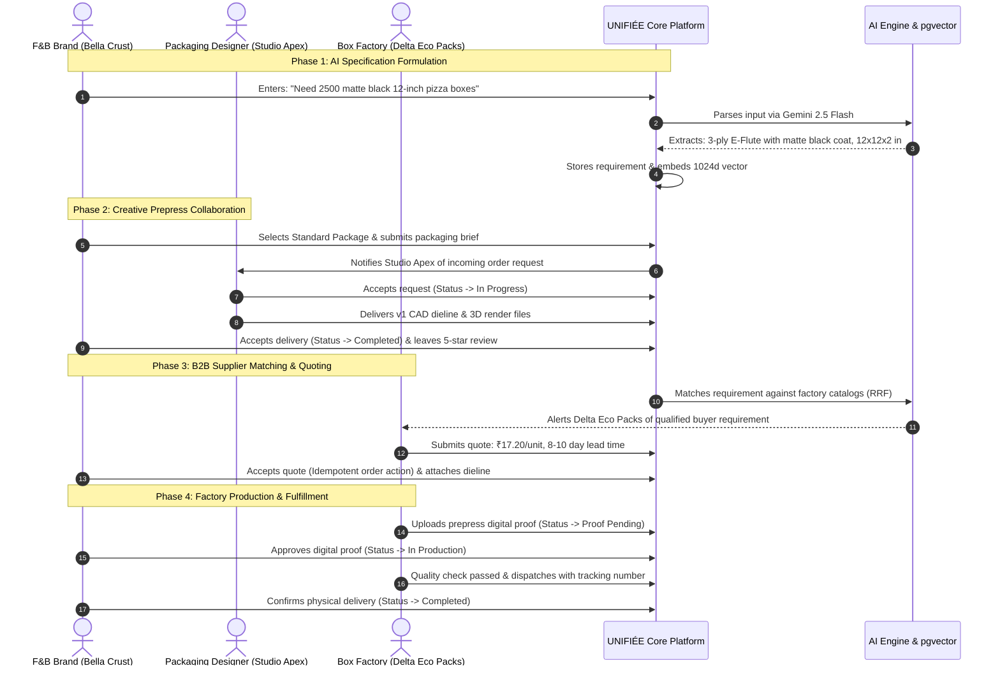
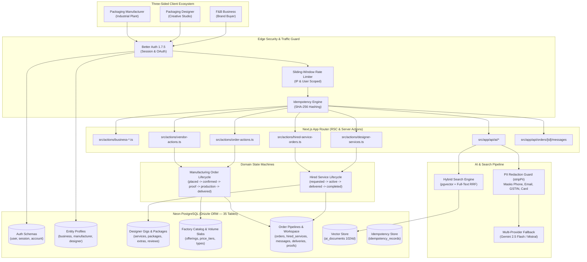
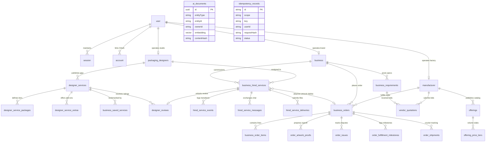
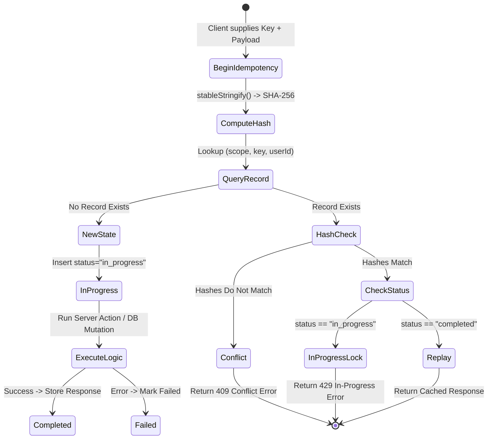
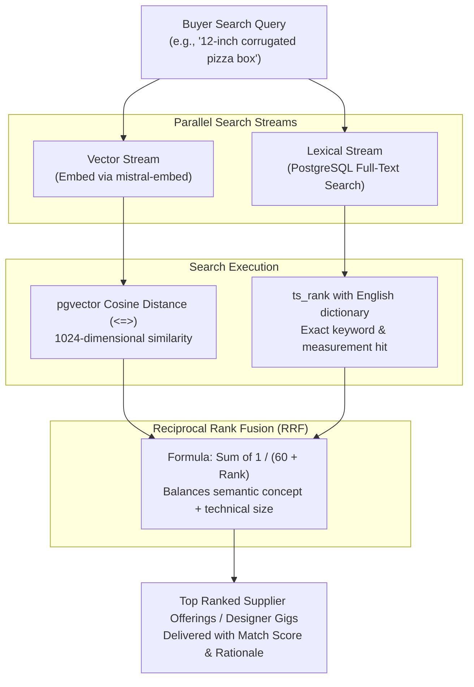
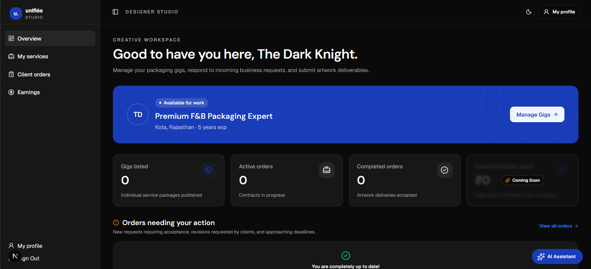
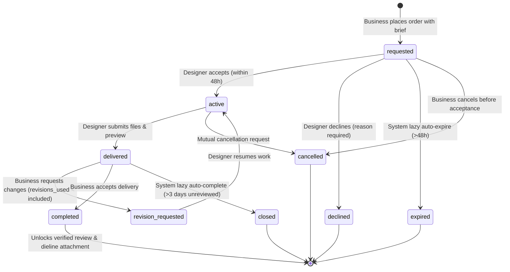
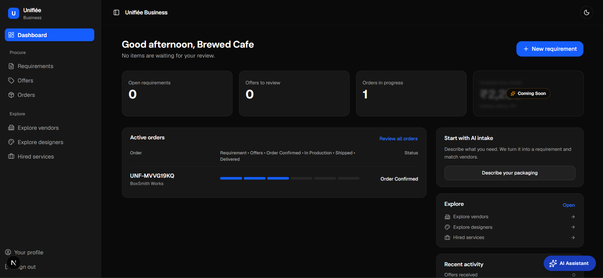
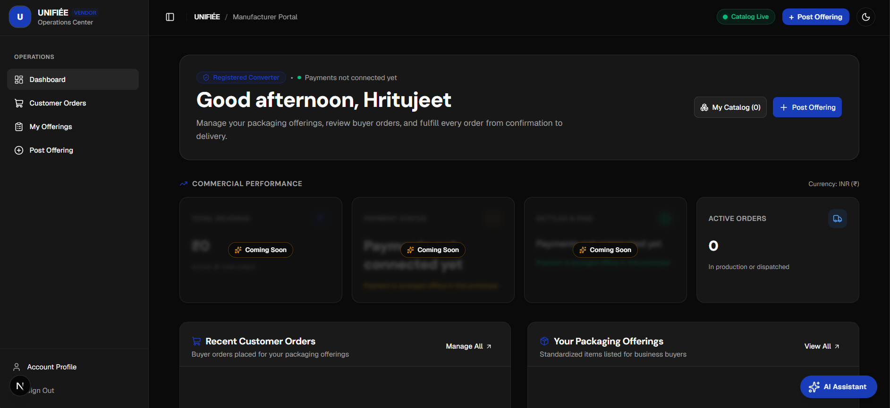

```mermaid
stateDiagram-v2
    [*] --> placed: Brand accepts converter quote
    placed --> confirmed: Converter confirms order capacity
    placed --> rejected: Converter rejects order (with reason)
    placed --> cancelled: Brand cancels order
    
    confirmed --> proof_pending: Converter uploads digital dieline proof
    proof_pending --> proof_approved: Brand reviews & signs off on prepress proof
    
    proof_approved --> in_production: Factory begins printing & die-cutting
    in_production --> quality_check: Production finished; QA inspection
    quality_check --> dispatched: Courier pickup (with tracking number & ETA)
    
    dispatched --> delivered: Courier marks delivered
    delivered --> completed: Brand inspects boxes & confirms delivery
    
    completed --> [*]: Order successfully archived
    rejected --> [*]
    cancelled --> [*]
```

# UNIFIÉE — Comprehensive System Architecture & Engineering Documentation

## 1. Project Overview

### 1.1 Executive Summary & Conceptual Mental Model
**UNIFIÉE** is an end-to-end B2B operating system engineered specifically for the Food and Beverage (F&B) custom packaging procurement and prepress lifecycle.

To understand UNIFIÉE without reading thousands of lines of code, think of it as a purpose-built industrial coordination engine:
- **Part Creative Studio Marketplace**: A specialized Fiverr-style creative exchange where independent packaging designers publish tiered service gigs (Basic, Standard, Premium packages with optional extras and FAQs) for CAD dielines, label artwork, and 3D mockups.
- **Part B2B Manufacturing Exchange**: An industrial catalog and quoting engine enabling corrugated box converters, paper cup fabricators, and commercial flexographic/offset printers to list live factory lines with tiered volume discount slabs.
- **Part Prepress & Production Workflow Hub**: Unlike generic marketplaces that terminate upon introduction, UNIFIÉE orchestrates the mechanical pipeline—from transforming rough conversational buyer notes into engineering specifications (board grammage, flute profile, grease barriers), to in-app collaborative design workspaces with versioned dieline deliveries, to digital prepress proof signoffs and live factory fulfillment milestone tracking.

### 1.2 The Three Stakeholders
The platform unites three distinct user personas, each operating inside a customized dashboard:
1. **F&B Businesses (Buyers)**: Independent cafés, multi-outlet restaurant chains, quick-service restaurants (QSRs), cloud kitchens, and artisanal bakeries seeking custom, food-safe packaging.
2. **Packaging Designers (Creators)**: Specialized structural packaging designers, prepress artwork specialists, and 3D rendering studios delivering production-ready CAD dielines and label vector files.
3. **Packaging Manufacturers & Printers (Converters)**: Industrial converting plants, flexographic/offset packaging printers, corrugated carton factories, and paper cup fabricators.

### 1.3 The Core Problem Space in Plain English
Procuring custom packaging for food brands is notoriously error-prone, opaque, and slow:
- **The "Speaking Different Languages" Problem**: A café owner might say, *"I need a sturdy, premium brown takeaway box for burgers that doesn't get soggy on delivery."* An industrial packaging converter cannot quote on that statement. The converter needs mechanical specifications: *What dimensions in millimeters? What board grammage (e.g., 280 GSM vs. 350 GSM)? What flute profile (E-flute vs. B-flute)? What inner barrier coating (aqueous dispersion vs. PE liner) to resist hot steam and grease?*
- **The Prepress Artwork Failure**: Graphic designers often design beautiful logos in RGB color spaces without understanding factory die-cutting tolerances, bleed margins, or crease lines. When files are sent directly to converters, the printing plates fail or the boxes fold incorrectly, resulting in wasted production runs worth thousands of dollars.
- **The Minimum Order Quantity (MOQ) Wall**: Independent food outlets cannot meet the 50,000-unit minimum order quantities of tier-one manufacturers, while converters waste valuable sales hours answering small, unqualified inquiries.

### 1.4 How UNIFIÉE Solves This
1. **AI Packaging Engineer**: An in-app artificial intelligence assistant (powered by Google Gemini 2.5 Flash) extracts exact industrial specifications from rough buyer notes and automatically builds an engineering brief.
2. **Tiered Designer Gigs & Collaborative Prepress Workspace**: The brand discovers vetted packaging designers, selects structured packages (Basic/Standard/Premium), fills an engineering brief, and collaborates in a dedicated workspace with versioned file deliveries, revision tracking, and direct in-app messaging.
3. **Hybrid Intelligent Supplier Matching**: Technical specifications are semantically matched with live factory catalogs using hybrid search (combining Mistral AI vector embeddings with exact keyword filters via Reciprocal Rank Fusion).
4. **Closed-Loop Dieline Hand-off & Factory Order Lifecycle**: Completed design dielines attach directly to manufacturing purchase orders (`linked_order_id`). The factory reviews the CAD files, uploads digital proofs for client signoff, and advances production through a rigid 9-stage state machine with live milestone updates and shipment tracking.

TEAM INPUT NEEDED: Commercial traction numbers, target regional hubs for the Eureka competition pilot, and founding team background.

---

## 2. Technical Stack Breakdown

### 2.1 Plain-English Guide to the Tech Stack
For non-coders evaluating the architecture, here is what each layer does and why it was chosen:

| Layer | Technology & Version | Plain-English Role | Why It Matters for This Product |
| :--- | :--- | :--- | :--- |
| **User Interface Framework** | Next.js 16.3.5 (App Router) | Web application engine | Combines fast screen loading (Server Components) with instant updates when clicking buttons (Server Actions), eliminating sluggish page reloads. |
| **Programming Language** | TypeScript 5.x | Strict safety net | Prevents bugs before they reach users by enforcing strict data types across forms, database queries, and AI outputs. |
| **Design & Styling Engine** | Tailwind CSS v4 & PostCSS | Design layout system | Modern utility-first styling with zero runtime JavaScript overhead, optimized for mobile phones and factory screens. |
| **Interactive UI Primitives** | Radix UI & Base UI | Accessible interface blocks | Ensures accessible dialogs, dropdowns, and slide-out drawers that support keyboard navigation and screen readers. |
| **Animations & Icons** | Motion 13.3.0 & Lucide React | Visual polish and smooth movement | Powers smooth transitions between onboarding steps, modals, and status badges. |
| **Server Cache & Refetching** | TanStack React Query 5.103.2 | Data freshener | Keeps marketplace listings, in-app workspace messages (15s polling), and incoming quotes automatically synchronized. |
| **Forms & Input Validation** | React Hook Form 7.88 & Zod 4.6.5 | Input inspector | Validates packaging briefs, dimensions, GSTIN tax IDs, and tiered package prices on both client and server before saving. |
| **Database Engine** | PostgreSQL on Neon | Secure cloud vault | Serverless relational database providing transaction ACID guarantees, connection pooling (`DATABASE_URL`), and unpooled DDL endpoints (`DATABASE_URL_UNPOOLED`). |
| **AI Vector Search Extension** | pgvector Extension | Semantic memory index | Enables the database to understand the "meaning" of packaging requests rather than just matching exact words. |
| **Database Connector (ORM)** | Drizzle ORM 1.0.0-rc.4 & Drizzle Kit | Database translator | Converts TypeScript code into high-speed SQL queries with compile-time type safety. |
| **Security & Authentication** | Better Auth 1.7.5 | Identity & session manager | Securely logs in users with passwords or Google OAuth, generates encrypted session cookies, and defends against brute-force attacks. |
| **AI Orchestration Framework** | Vercel AI SDK 7.0 (`ai: 7.0.152`) | AI bridge | Connects the application to modern LLMs with streaming text and guaranteed JSON output structures. |
| **Primary AI Reasoning Model** | Google Gemini 2.5 Flash (`@ai-sdk/google`) | Automated packaging consultant | Fast model that extracts structured industrial packaging parameters from rough buyer notes. |
| **Secondary Fallback Model** | Mistral Small (`@ai-sdk/mistral`) | Backup AI generator | Automated safety backup model that takes over if primary API quotas or rate limits are reached. |
| **Vector Embedding Model** | Mistral Embed (`mistral-embed`) | Semantic mathematical translator | Converts packaging listings, designer gigs, and customer inquiries into 1024-dimensional mathematical vectors for search. |
| **File Storage Architecture** | HTTPS URL Pointers | Asset reference layer | In the prototype, artwork and dieline files live on external HTTPS URLs (Figma, Drive, portfolio links) stored in Postgres. S3/R2 presigned upload buckets are scheduled for production. |
| **Transactional Email** | Resend 6.29.0 | Notification courier | Sends automated email confirmations when design orders are placed, accepted, delivered, or updated. |
| **Package Manager** | npm (v10+) | Dependency manager | Standard deterministic dependency management via `package-lock.json`. |

---

## 3. System Architecture & The Three-Sided Closed Loop

### 3.1 Real-World Journey: "Bella Crust Pizza"
To understand how data travels through UNIFIÉE, consider the journey of an artisanal pizzeria named **"Bella Crust" (illustrative)**:
1. **Requirement Formulation**: Bella Crust inputs rough notes: *"Need 2500 matte black 12-inch pizza boxes"*. Gemini 2.5 Flash parses the prompt into: **3-ply E-Flute Corrugated Board with matte black flood-coat exterior printing and grease-resistant food liner**, 12x12x2 in dimensions, 2-color brand logo print.
2. **Creative Prepress Collaboration**: Bella Crust browses `/business/designers`, filters for "dieline structural" and "boxes", and selects Studio Apex's Standard package (₹6,500 [illustrative], 3-day turnaround, CAD dieline + 3D mockup, 3 revisions). Bella Crust completes the structured packaging brief form. Studio Apex accepts the request, models the CAD dieline to exact manufacturing fold tolerances, and delivers vector files in the workspace. Bella Crust reviews and accepts delivery.
3. **Supplier Matching & Bidding**: The technical specification is matched against converter catalogs using hybrid search (pgvector + full-text RRF). Delta Eco Packs submits a binding quote of ₹17.20/box with an 8–10 day lead time.
4. **Artwork Linking & Factory Production**: Bella Crust accepts Delta Eco Packs (illustrative, ₹17.20/box) quotation and attaches the completed Studio Apex dieline to the manufacturing order. Delta Eco Packs uploads a digital prepress proof for final confirmation. Bella Crust approves the proof, and the order moves through production (`in_production` -> `quality_check` -> `dispatched` with tracking -> `delivered` -> `completed`).



### 3.2 System Architecture Diagram


---

## 4. Database Schema & Data Model Teardown

### 4.1 Plain-English Database Guide
The database contains **35 distinct tables** grouped into six functional categories:
1. **Identity & Security (5 tables)**: User authentication credentials, active sessions, social provider links, email verifications, and cryptographic idempotency audit records (`user`, `session`, `account`, `verification`, `idempotency_records`).
2. **Profiles & Facilities (4 tables)**: Legal restaurant registrations, packaging converter facilities and machinery capabilities, and verified designer portfolios (`business`, `manufacturer`, `vendor_facilities`, `packaging_designers`).
3. **Factory Catalog & Volume Discount Slabs (4 tables)**: Standardized packaging classifications, factory manufacturing offerings, volume pricing slabs, and catalog imagery (`offering_types`, `offerings`, `offering_price_tiers`, `offering_images`).
4. **Fiverr-Style Designer Gigs & Collaborative Services (9 tables)**: Tiered design gigs, Basic/Standard/Premium packages, gig add-ons, buyer saved services, hired orders, chronological status events, versioned file deliveries, in-app conversation threads, and post-completion reviews (`designer_services`, `designer_service_packages`, `designer_service_extras`, `business_saved_services`, `business_hired_services`, `hired_service_events`, `hired_service_messages`, `hired_service_deliveries`, `designer_reviews`).
5. **Manufacturing Orders & Prepress Pipeline (8 tables)**: Client specifications, supplier bids, purchase orders, order line items, prepress artwork proofs, dispute tickets, fulfillment milestones, and shipment tracking (`business_requirements`, `vendor_quotations`, `business_orders`, `business_order_items`, `order_artwork_proofs`, `order_issues`, `order_fulfillment_milestones`, `order_shipments`).
6. **AI Vectors & Commercial Records (7 tables)**: 1024-dimensional semantic embeddings for hybrid discovery, vendor inquiries, supplier review ratings, commercial invoices, and payout accounts (`ai_documents`, `vendor_inquiries`, `vendor_reviews`, `vendor_invoices`, `vendor_payout_accounts`).

### 4.2 Entity-Relationship Diagram (ERD)


### 4.3 Key Schema Implementations
Below are representative Drizzle ORM definitions enforcing domain constraints at the database level:

```typescript
// src/lib/db/schema/designer-service.ts
export const designerServicePackagesTable = pgTable("designer_service_packages", {
    id: uuid("id").primaryKey().notNull(),
    serviceId: uuid("service_id").notNull().references(() => designerServiceTable.id, { onDelete: "cascade" }),
    tier: packageTierEnum("tier").notNull(), // basic | standard | premium
    name: varchar("name", { length: 100 }).notNull(),
    description: text("description").notNull(),
    price: numeric("price", { precision: 12, scale: 2 }).notNull(),
    deliveryDays: integer("delivery_days").notNull(),
    revisionsIncluded: integer("revisions_included").notNull().default(2), // -1 for unlimited
    deliverables: json("deliverables").$type<string[]>().notNull().default([]),
    sourceFilesIncluded: boolean("source_files_included").notNull().default(false),
    commercialUseIncluded: boolean("commercial_use_included").notNull().default(true),
    createdAt: timestamp("created_at").defaultNow().notNull(),
}, (table) => [
    index("designer_service_packages_service_idx").on(table.serviceId),
    uniqueIndex("designer_service_packages_service_tier_unique").on(table.serviceId, table.tier),
])
```

```typescript
// src/lib/db/schema/order-lifecycle.ts
export const orderArtworkProofsTable = pgTable("order_artwork_proofs", {
    id: uuid("id").primaryKey().notNull(),
    orderId: uuid("order_id").notNull().references(() => businessOrdersTable.id, { onDelete: "cascade" }),
    version: integer("version").notNull(),
    fileUrl: text("file_url").notNull(),
    status: orderProofStatusEnum("status").notNull().default("pending"),
    feedback: text("feedback"),
    uploadedBy: text("uploaded_by").notNull().references(() => user.id, { onDelete: "restrict" }),
    decidedBy: text("decided_by").references(() => user.id, { onDelete: "set null" }),
    decidedAt: timestamp("decided_at"),
    createdAt: timestamp("created_at").notNull().defaultNow(),
}, (table) => [
    index("order_artwork_proofs_order_idx").on(table.orderId),
    uniqueIndex("order_artwork_proofs_order_version_unique").on(table.orderId, table.version),
])
```

---

## 5. Security, Idempotency & Rate Limiting Infrastructure

### 5.1 The Anti-Double-Billing Safeguard: Idempotency in Plain English
In physical B2B purchasing and creative commissioning, an accidental double-click on a flaky mobile connection could create duplicate orders and lock up thousands of rupees.

UNIFIÉE solves this using **Cryptographic Idempotency**:
1. When a user submits an order, the server normalizes the payload into a deterministic string representation.
2. It computes an **SHA-256 cryptographic hash** of the normalized payload.
3. It checks `idempotency_records`:
   - If unseen: It locks the transaction (`status: "in_progress"`), executes the database mutation, caches the result, and sets `status: "completed"`.
   - If matching request arrives while processing: The server returns an `in_progress` error (HTTP 429), preventing duplicate concurrent executions.
   - If matching request arrives after completion: The server **replays the cached response directly without re-executing any database writes**.
   - If an existing key is reused with modified payload data: The server immediately raises a `conflict` error (HTTP 409).



### 5.2 Deterministic Key Sorting Code
```typescript
// src/lib/server/idempotency-core.ts
function stableStringify(value: unknown): string {
    if (value === null || typeof value !== "object") return JSON.stringify(value)
    if (Array.isArray(value)) return `[${value.map(stableStringify).join(",")}]`
    const record = value as Record<string, unknown>
    return `{${Object.keys(record).sort().map((key) => `${JSON.stringify(key)}:${stableStringify(record[key])}`).join(",")}}`
}

export function hashIdempotencyPayload(payload: unknown): string {
    return crypto.createHash("sha256").update(stableStringify(payload)).digest("hex")
}
```

---

## 6. AI Architecture, Hybrid RAG & Privacy Controls

### 6.1 How the AI Thinks & Searches: Hybrid Search in Plain English
Standard search engines fail when matching custom packaging:
- **Keyword Search Failure**: A café searching for *"biodegradable salad packaging"* misses a converter listing titled *"Compostable Sugarcane Bagasse Bowl 500ml"* due to vocabulary mismatch.
- **Pure Vector Search Failure**: Vector embeddings understand conceptual meaning but struggle with exact numbers. Searching for *"8 oz cup"* frequently retrieves *"12 oz cup"* because both occupy nearly identical coordinates in latent space.
- **UNIFIÉE Hybrid Solution**: **Reciprocal Rank Fusion (RRF)**:
  1. Executes a **vector search** using Mistral Embed (1024-dimensional vectors) in `pgvector` for conceptual semantic similarity.
  2. Executes a parallel **PostgreSQL full-text search** (`ts_rank` with English dictionary) to reward exact dimensions, flute codes, and material numbers.
  3. Fuses both ranked lists using the RRF formula $RRF = \sum \frac{1}{60 + \text{rank}}$, ensuring listings that match both concept and dimensions rank highest.



### 6.2 Data Privacy: Automated PII Stripping
Before prompts are transmitted to external LLM providers, personal contact details and tax identifiers are redacted via regex in `src/lib/ai/privacy.ts`:
```typescript
// src/lib/ai/privacy.ts
const EMAIL_REGEX = /[a-zA-Z0-9._%+-]+@[a-zA-Z0-9.-]+\.[a-zA-Z]{2,}/g;
const PHONE_REGEX = /(?:\+?\d{1,3}[-.\s]?)?\(?\d{3}\)?[-.\s]?\d{3}[-.\s]?\d{4}\b/g;
const GSTIN_REGEX = /\b[0-9]{2}[A-Z]{5}[0-9]{4}[A-Z]{1}[1-9A-Z]{1}Z[0-9A-Z]{1}\b/gi;
const CARD_REGEX = /\b(?:\d{4}[-\s]?){3}\d{1,4}\b/g;

export function stripPii(input: string | null | undefined): string {
    if (!input) return "";
    return input
        .replace(EMAIL_REGEX, "[REDACTED_EMAIL]")
        .replace(PHONE_REGEX, "[REDACTED_PHONE]")
        .replace(GSTIN_REGEX, "[REDACTED_GSTIN]")
        .replace(CARD_REGEX, "[REDACTED_CARD]")
        .trim();
}
```

---

## 7. Comprehensive Feature Breakdown

---

### 7.1 Authentication, Social Sign-In & Sliding-Window Rate Limiting
- **Plain-English Comprehension**:
  Allows users to securely create an account or sign in using email or Google. If an OAuth user joins, the system ensures they configure a password so they are never locked out. Sliding-window IP rate limiting prevents automated account enumeration and email harvesting by limiting lookup attempts to 5 per minute per IP.
- **Technical Architecture**: The form (`src/components/site/login-form.tsx`) sends a request to `POST /api/auth/check-email`. The server applies rate limiting (`src/lib/server/rate-limit.ts`) and inspects `user` and `account` in `auth-schema.ts`. Credential validation is handled by Better Auth (`src/lib/auth.ts`).
- **Key code snippet**:
```typescript
// src/app/api/auth/check-email/route.ts
const rateCheck = await checkRateLimit(
  { keyPrefix: "check-email", limit: 5, windowSeconds: 60 },
  clientIp
);
if (!rateCheck.success) {
  return NextResponse.json(
    { status: "error", error: "Too many sign-in attempts. Please wait a minute." },
    { status: 429, headers: { "Retry-After": String(rateCheck.resetInSeconds) } }
  );
}
```

---

### 7.2 Multi-Role Onboarding & Pathway Routing
- **Plain-English Comprehension**:
  A three-step onboarding wizard that routes accounts into their dedicated portal (Business, Manufacturer, or Designer). It captures legal business credentials (such as GSTIN tax IDs) and validates them on the server.
- **Technical Architecture**: `src/components/site/onboarding-form.tsx` guides the user and invokes `registerBusinessAction`, `registerManufacturerAction`, or `registerDesignerAction` in `src/actions/`.
- **Key code snippet**:
```typescript
// src/actions/business-registration.ts
export async function registerBusinessAction(data: z.infer<typeof businessOnboardingSchema>) {
    const session = await auth.api.getSession({ headers: await headers() });
    if (!session?.user) return { success: false, error: "Must be signed in." };

    const rateCheck = await checkRateLimit({ keyPrefix: "business-reg", limit: 5, windowSeconds: 600 }, session.user.id);
    if (!rateCheck.success) return { success: false, error: "Too many attempts." };

    await db.insert(business).values({ id: crypto.randomUUID(), userId: session.user.id, ...data });
    return { success: true };
}
```

---

### 7.3 AI-Assisted Packaging Specification Extractor
- **Plain-English Comprehension**:
  Extracts specs from rough notes. A restaurant owner can type unstructured notes (e.g., *"Need 2500 burger boxes 6x6x3 inches that won't get soggy on delivery"*) and the AI extracts technical specifications (E-flute corrugated kraft, grease-resistant barrier, 6x6x3 in).
- **Technical Architecture**: Executes `POST /api/ai/requirements/extract` using Google Gemini 2.5 Flash and `Output.object({ schema: aiRequirementOutputSchema })`.
- **Key code snippet**:
```typescript
// src/app/api/ai/requirements/extract/route.ts
const result = await generateText({
    model: getModel("requirement_builder"),
    output: Output.object({ schema: aiRequirementOutputSchema }),
    system: buildRequirementBuilderSystemPrompt(),
    prompt: stripPii(parseResult.data.prompt),
    abortSignal: AbortSignal.timeout(15000),
});
```

---

### 7.4 Semantic Vendor & Designer Matching via Hybrid RAG
- **Plain-English Comprehension**:
  Matches customer packaging requirements with factory product lines and designer portfolios. It ranks candidates by combining AI conceptual understanding with exact size and quantity relevance, boosting exact matches alongside semantic similarity.
- **Technical Architecture**: The route `src/app/api/ai/requirements/search-vendors/route.ts` runs vector search (`<=>`) and full-text search, fused via Reciprocal Rank Fusion.
- **Key code snippet**:
```typescript
// src/app/api/ai/requirements/search-vendors/route.ts
const context: SessionContext = { userId: session.user.id, role: "business", businessId: owner.id };
const vectorResults = await searchVector(queryDocument.embedding, context, parsed.data.limit * 2);
const textResults = await searchFullText(queryDocument.content, context, parsed.data.limit * 2);
const merged = reciprocalRankFusion(vectorResults, textResults).slice(0, parsed.data.limit);
```

---

### 7.5 Quotation Acceptance & Cryptographic Idempotent Purchase Orders
- **Plain-English Comprehension**:
  Allows brands to accept a manufacturer's quote with a single click. It automatically declines competing bids, creates a purchase order, and prevents accidental duplicate orders using SHA-256 fingerprinting.
- **Technical Architecture**: Server Action `createOrderFromQuoteAction` in `src/actions/order-actions.ts` runs `beginIdempotency()` with an SHA-256 hash before inserting into `business_orders`.
- **Key code snippet**:
```typescript
// src/actions/order-actions.ts
const profile = await getBusinessForSession()
if (!profile || profile.id !== parsed.data.businessId) return { success: false, error: "Unauthorized." };

const idempotency = idempotencyResponse(await beginIdempotency("create-order", parsed.data.idempotencyKey ?? crypto.randomUUID(), profile.id, parsed.data));
if (idempotency.handled) return idempotency.response as OrderActionResult<{ orderId: string; orderNumber: string; status: "confirmed" }>;
```

---

### 7.6 Fiverr-Style Packaging Designer Gigs, Tiered Packages & AI Gig Studio
- **Plain-English Comprehension**:
  A creative services studio where packaging designers build modular gigs with tiered pricing (Basic, Standard, Premium packages), optional gig extras (such as 3D renders or fast delivery), and FAQs. Designers use an in-app AI copy generator to draft compelling service descriptions and package deliverables. Publishing enforces profile completeness (bio and specialization) to guarantee high platform quality.


*Figure: Packaging Designer Studio displaying studio overview, profile strength card, and gig listing entry point*

- **Technical Architecture**: Component `src/components/designer/gig-editor-dialog.tsx` provides a 5-step wizard (`Overview -> Packages -> Gallery -> FAQ -> Review & Publish`). Server Action `saveDesignerGigAction` in `src/actions/designer-services.ts` verifies profile completeness, saves package tiers into `designer_service_packages`, and synchronizes vector embeddings in `ai_documents` via `syncEntityEmbeddings`.
- **Key code snippet**:
```typescript
// src/actions/designer-services.ts
if (parsed.data.status === "published") {
    const hasBio = Boolean(designer.bio && designer.bio.trim().length >= 10)
    const hasSpecialization = Boolean(
        (designer.packagingDesignSpecializations && designer.packagingDesignSpecializations.length > 0) ||
        (designer.specializations && designer.specializations.length > 0)
    )

    if (!hasBio || !hasSpecialization) {
        return {
            success: false,
            error: "Profile completeness required to publish: please complete your bio and add at least one specialization in your Profile.",
        }
    }
}

const basicPackage = parsed.data.packages.find((p) => p.tier === "basic")
if (!basicPackage) {
    return { success: false, error: "Basic package tier is mandatory." }
}
```

---

### 7.7 Creative Marketplace Discovery, Faceted Filtering & Saved Gigs
- **Plain-English Comprehension**:
  The buyer discovery portal where F&B brand managers search for packaging designers. Brands can filter by packaging category (dieline/structural, labels, 3D renders), supported packaging types (boxes, cups, pouches), price range based on the Basic tier, delivery speed, and software skills. Brands can bookmark gigs into their "Saved" tab for easy access.
- **Technical Architecture**: Page `src/app/business/designers/page.tsx` renders `designer-marketplace.tsx`. Queries in `src/lib/business/marketplace.ts` run hybrid search combining PostgreSQL full-text search with `pgvector` embedding distances. The gig detail view (`src/components/business/gig-detail-view.tsx`) displays an interactive package comparison matrix, FAQ accordions, verified review ratings, and a sticky checkout purchase panel.
- **Key code snippet**:
```typescript
// src/lib/business/marketplace.ts
export async function getMarketplaceGigs(filters: MarketplaceFilterInput) {
    const conditions = [
        eq(designerServiceTable.status, "published"),
        isNull(designerServiceTable.deletedAt),
    ]

    if (filters.category && filters.category !== "all") {
        conditions.push(eq(designerServiceTable.category, filters.category as any))
    }

    // Dynamic join on basic package for price filter and sorting
    const baseQuery = db
        .select({
            gig: designerServiceTable,
            designer: packagingDesignerTable,
            basicPrice: sql<number>`min(${designerServicePackagesTable.price})::float`,
            minDeliveryDays: sql<number>`min(${designerServicePackagesTable.deliveryDays})`,
        })
        .from(designerServiceTable)
        .innerJoin(packagingDesignerTable, eq(designerServiceTable.designerId, packagingDesignerTable.id))
        .leftJoin(designerServicePackagesTable, eq(designerServiceTable.id, designerServicePackagesTable.serviceId))
```

---

### 7.8 Design Order Checkout, Structured Packaging Brief & Offline Payment Safeguards
- **Plain-English Comprehension**:
  When a business chooses a design package, they proceed to checkout where they select optional extras and complete a structured industrial packaging brief (specifying packaging type, dimensions, materials, brand colors, fonts, target audience, dieline availability, and required file formats). A prominent notice confirms that payment is arranged directly between the brand and designer. Cryptographic idempotency protects against duplicate submissions.
- **Technical Architecture**: Form `src/components/business/order-checkout-form.tsx` validates data via Zod schema `placeDesignOrderSchema`. Server Action `placeDesignOrderAction` in `src/actions/hired-service-orders.ts` blocks self-hiring, snapshots package deliverables and brief JSON into `business_hired_services`, logs initial status `requested` into `hired_service_events`, and triggers an email notification via Resend.
- **Key code snippet**:
```typescript
// src/actions/hired-service-orders.ts
// Block hiring own gig
if (gig.designerUserId === session.user.id) {
    const res = { success: false, error: "You cannot order your own design gig." }
    await completeIdempotency(idempotency.id, res)
    return res
}

// Calculate total and due date
const extrasTotal = selectedExtras.reduce((sum, e) => sum + Number(e.price), 0)
const totalPrice = Number(pkg.price) + extrasTotal
const totalDays = pkg.deliveryDays + selectedExtras.reduce((sum, e) => sum + e.extraDays, 0)

await tx.insert(businessHiredServiceTable).values({
    id: orderId,
    businessId: biz.id,
    serviceId: gig.id,
    designerId: gig.designerId,
    serviceTitle: gig.title,
    designerName: gig.designerName || gig.fullName,
    designerEmail: gig.designerEmail,
    packageTier: pkg.tier,
    packageName: pkg.name,
    price: String(totalPrice),
    deliveryDays: totalDays,
    revisionsIncluded: pkg.revisionsIncluded,
    revisionsUsed: 0,
    extras: selectedExtras,
    brief: parsed.data.brief,
    status: "requested",
})
```

---

### 7.9 Collaborative Prepress Design Workspace, Versioned Deliveries & Real-Time Messaging Thread
- **Plain-English Comprehension**:
  A unified digital workspace shared between the brand and designer. Both sides view an interactive stepper tracking the order from *Requested* to *In Progress*, *Delivered*, and *Completed*. The workspace features:
  - **Read-Only Brief Tab**: Clear review of packaging requirements and brand guidelines.
  - **Live Conversation Thread**: In-app messaging polling every 15 seconds with unread badges.
  - **Versioned Deliveries**: Designers upload revision files with release notes and preview links; brands inspect files and can either "Accept Delivery" or "Request Revision" (enforcing the package's revision limit).
  - **Lazy Auto-Actions**: If a designer doesn't respond to a request within 48 hours, it automatically expires. If a brand doesn't respond to a delivery within 3 days, it lazily auto-completes.
- **Technical Architecture**: Component `src/components/hired-services/hired-service-workspace.tsx` leverages TanStack Query for polling `GET /api/orders/[id]/messages`. Lifecycle transitions are evaluated against `canTransition` in `src/lib/hired-services/lifecycle.ts`. Every state change is recorded in `hired_service_events` within a database transaction.
- **Key code snippet**:
```typescript
// src/lib/hired-services/lifecycle.ts
export const allowedTransitions: Record<HiredServiceRole, Partial<Record<HiredServiceStatus, readonly HiredServiceStatus[]>>> = {
    business: {
        requested: ["cancelled"],
        delivered: ["completed", "revision_requested"],
        active: ["cancelled"],
    },
    designer: {
        requested: ["active", "declined"],
        active: ["delivered"],
        revision_requested: ["active", "delivered"],
    },
    system: {
        requested: ["expired"], // 48h timeout
        delivered: ["completed", "closed"], // 3d auto-complete
    },
}

export function canTransition(from: HiredServiceStatus, to: HiredServiceStatus, role: HiredServiceRole): boolean {
    if (from === to) return true
    return allowedTransitions[role][from]?.includes(to) ?? false
}
```



---

### 7.10 Verified Post-Completion Reviews & Instant SQL Rating Aggregates
- **Plain-English Comprehension**:
  Reviews can only be submitted after an order is successfully completed, eliminating fake or unverified feedback. The brand rates the designer on an overall 1–5 star scale alongside three detailed sub-ratings: *Communication*, *Service Quality*, and *As Described*. Designers can post a public reply. Rating averages are immediately recomputed across all reviews and updated on both the gig and the designer profile. Reviews are permanently locked against edits after 7 days.
- **Technical Architecture**: Server Action `submitDesignerReviewAction` in `src/actions/hired-service-orders.ts` checks that `order.status === "completed"` and verifies that no prior review exists (`order_id UNIQUE`). Inside an atomic SQL transaction, it inserts into `designer_reviews` and executes SQL aggregations (`AVG(rating)` and `COUNT(*)`) to update `rating_avg` and `rating_count` on `designer_services` and `packaging_designers`.
- **Key code snippet**:
```typescript
// src/actions/hired-service-orders.ts
await tx.insert(designerReviewsTable).values({
    id: crypto.randomUUID(),
    orderId: order.id,
    serviceId: order.serviceId,
    designerId: order.designerId,
    businessId: order.businessId,
    rating: parsed.data.rating,
    communicationRating: parsed.data.communicationRating,
    qualityRating: parsed.data.qualityRating,
    asDescribedRating: parsed.data.asDescribedRating,
    text: parsed.data.text,
})

// Update gig rating aggregate in same transaction
const [gigAgg] = await tx
    .select({
        avg: sql<string>`round(avg(${designerReviewsTable.rating})::numeric, 2)`,
        count: sql<number>`count(${designerReviewsTable.id})::int`,
    })
    .from(designerReviewsTable)
    .where(eq(designerReviewsTable.serviceId, order.serviceId))

await tx
    .update(designerServiceTable)
    .set({
        ratingAvg: gigAgg.avg || "0",
        ratingCount: gigAgg.count || 0,
    })
    .where(eq(designerServiceTable.id, order.serviceId))
```

---

### 7.11 9-Stage Manufacturing Packaging Order Lifecycle & Prepress Proof Approval
- **Plain-English Comprehension**:
  Physical packaging production requires strict verification before raw materials are cut. UNIFIÉE enforces a 9-stage state machine for industrial orders:
  1. `placed`: Brand accepts a factory quote.
  2. `confirmed`: Converter confirms factory capacity.
  3. `proof_pending`: Converter uploads digital prepress dieline proofs.
  4. `proof_approved`: Brand inspects and signs off on digital proof (initiating print).
  5. `in_production`: Corrugation, printing, and die-cutting underway.
  6. `quality_check`: Food safety and structural compression inspection.
  7. `dispatched`: Order handed to courier with tracking URL and ETA.
  8. `delivered`: Courier marks shipment delivered.
  9. `completed`: Brand inspects physical boxes and confirms delivery.
  Brands can attach completed design dielines (`linked_order_id`) directly to the order to feed the prepress step.


*Figure: F&B Business Dashboard displaying active manufacturing order cards with the "Review proof" dieline signoff action*

- **Technical Architecture**: Defined in `src/lib/orders/lifecycle.ts`. State transitions are enforced by `canTransition(from, to, actor)`. Proof uploads write to `order_artwork_proofs` with automatic version incrementing. Dispute tickets are managed in `order_issues`. Milestones and courier dispatches write to `order_fulfillment_milestones` and `order_shipments`.
- **Key code snippet**:
```typescript
// src/lib/orders/lifecycle.ts
export const allowedTransitions: Record<OrderActor, Partial<Record<OrderStatus, readonly OrderStatus[]>>> = {
    business: {
        placed: ["cancelled"],
        confirmed: ["proof_pending", "cancelled"],
        proof_pending: ["proof_approved", "cancelled"],
        proof_approved: ["cancelled"],
        in_production: [],
        quality_check: [],
        dispatched: [],
        delivered: ["completed"],
    },
    manufacturer: {
        placed: ["confirmed", "rejected", "cancelled"],
        confirmed: ["proof_pending", "cancelled"],
        proof_pending: ["proof_approved"],
        proof_approved: ["in_production"],
        in_production: ["quality_check"],
        quality_check: ["dispatched"],
        dispatched: ["delivered"],
    },
    designer: {},
    system: {},
}
```



---

### 7.12 Manufacturer Operations Hub, Tiered Volume Pricing & Factory Milestones
- **Plain-English Comprehension**:
  The factory operations center where packaging converters manage catalog lines, configure tiered volume discount slabs (e.g., ₹15/box for 1,000 units vs. ₹10/box for 10,000 units), review incoming purchase orders, upload prepress proofs, and manage courier tracking details.


*Figure: Packaging Manufacturer Command Center displaying plant metrics, incoming order queues, and published offerings entry*

- **Technical Architecture**: Page `src/app/manufacturer/orders/[id]/page.tsx` renders `vendor-order-detail-view.tsx`. Actions in `src/actions/vendor-actions.ts` manage catalog offerings (`createOfferingAction`), update order statuses (`updateOrderStatusAction`), and upload artwork proofs (`uploadProofAction`).
- **Key code snippet**:
```typescript
// src/actions/vendor-actions.ts
export async function uploadProofAction(input: { orderId: string; fileUrl: string; note?: string }) {
    const vendor = await getAuthenticatedVendor()
    if (!vendor) return { success: false, error: "Unauthorized." }

    const [order] = await db.select({ id: businessOrdersTable.id, status: businessOrdersTable.status })
        .from(businessOrdersTable)
        .where(and(eq(businessOrdersTable.id, input.orderId), eq(businessOrdersTable.vendorId, vendor.manufacturerId)))
        .limit(1)

    if (!order || !canTransition(order.status as OrderStatus, "proof_pending", "manufacturer")) {
        return { success: false, error: "A proof can only be uploaded after the order is confirmed." }
    }

    const [latest] = await db.select({ version: orderArtworkProofsTable.version })
        .from(orderArtworkProofsTable)
        .where(eq(orderArtworkProofsTable.orderId, order.id))
        .orderBy(desc(orderArtworkProofsTable.version))
        .limit(1)

    await db.transaction(async (tx) => {
        await tx.insert(orderArtworkProofsTable).values({
            id: crypto.randomUUID(),
            orderId: order.id,
            version: (latest?.version ?? 0) + 1,
            fileUrl: input.fileUrl,
            uploadedBy: vendor.userId,
        })
        await tx.update(businessOrdersTable).set({ status: "proof_pending", updatedAt: new Date() })
            .where(eq(businessOrdersTable.id, order.id))
    })
    return { success: true }
}
```

---

### 7.13 Context-Aware Floating AI Assistant & Multi-Model Orchestration
- **Plain-English Comprehension**:
  A 24/7 packaging consultant accessible in the corner of every screen. Users can ask technical questions (e.g., *"What GSM should I use for a hot coffee sleeve?"*) or request navigation help without leaving their dashboard.
- **Technical Architecture**: Component `src/components/ai/assistant-panel.tsx` streams responses from `POST /api/ai/assistant` using Vercel AI SDK `toTextStreamResponse`.
- **Key code snippet**:
```typescript
// src/app/api/ai/assistant/route.ts
const result = streamText({
    model: getModel("assistant_chat"),
    system: buildAssistantSystemPrompt(role, userContext, knowledgeContext),
    messages: cleanMessages,
});

return result.toTextStreamResponse({
    headers: responseHeaders,
});
```

---

## 8. Build, Environment & Evaluator Demo Walkthrough

### 8.1 Prerequisites & Installation
- **Node.js 20.x or higher**, npm 10.x+, and a PostgreSQL 15+ database with the `pgvector` extension enabled.
- Clone repository and run `npm install`.

### 8.2 Required Environment Variables (`.env.local`)
Create a `.env.local` file containing the following keys:
- `DATABASE_URL`: Pooled PostgreSQL connection string (Neon pooler) used for all application queries.
- `DATABASE_URL_UNPOOLED`: Direct PostgreSQL connection string used for schema migrations with `drizzle-kit`.
- `BETTER_AUTH_SECRET`: 32-character secret key used to sign and encrypt session cookies.
- `BETTER_AUTH_URL`: Canonical root URL of the application (e.g., `http://localhost:3000`).
- `NEXT_PUBLIC_BASE_URL`: Public base URL used for client redirects and canonical links.
- `GOOGLE_CLIENT_ID` / `GOOGLE_CLIENT_SECRET`: Google OAuth 2.0 credentials for social sign-in.
- `GEMINI_API_KEY`: Google Generative AI key for Gemini 2.5 Flash spec extraction and conversational assistant.
- `MISTRAL_API_KEY`: Mistral AI key for `mistral-embed` vector generation and secondary model failover.
- `RESEND_API_KEY`: Resend API key for transactional email notifications.

### 8.3 Evaluator Demo Script: Step-by-Step Testing
To test the complete three-sided workflow as an evaluator:
1. **Start Server**: Run `npm run dev` and open `http://localhost:3000`.
2. **Onboarding Experience**: Click "Get Started" -> Select "I'm an F&B Business" -> Fill out the brand details form to enter the Business Portal.
3. **Test AI Spec Extractor**: Navigate to `/business/requirements/new`. Click the "Pizza Boxes" prompt preset. Click "Parse with AI". Observe Gemini 2.5 Flash parse dimensions, GSM, and flute profiles into structured fields.
4. **Test Designer Marketplace & Gigs**: Navigate to `/business/designers`. Search for "dieline", filter by "boxes", and click a gig card. Inspect the package comparison table (Basic, Standard, Premium), FAQ, and reviews. Click "Continue", fill out the packaging brief form, and click "Place Design Order".
5. **Test Design Collaboration Workspace**: Open the resulting order at `/business/hired-services/[id]`. Switch between the Brief, Messages, and Deliveries tabs. Test posting a message and observing unread badge tracking.
6. **Test Proof Approval in Manufacturing**: Navigate to `/business`. On the active manufacturing order, click "Review proof". Inspect the digital dieline dialog and click "Approve Proof & Start Print" to see the order transition to "In Production".
7. **Test Factory Operations**: Visit `/manufacturer` to view production milestones, upload prepress proofs, and manage dispatch tracking.

---

## 9. Prototype Limitations & Production Roadmap

In accordance with competition transparency guidelines, the following items represent prototype boundaries in the current MVP build:

1. **Payment & Escrow UI is a Visual Placeholder**: The payment and status badges (*"Registered Converter"*, *"Payments not connected yet"*, *"Settled offline"* / *"Direct settlement"* / *"Pending Payment"*) and monetary balances shown in screenshots are front-end design mockups demonstrating the intended user experience. Live payment gateways (Razorpay/Stripe) and banking disbursements are not connected. Both checkout and order views explicitly display: *"Payment is arranged directly between you and the designer. Online payments are not connected yet."*
2. **Factory Handoff is Simulated**: Clicking "Approve Proof" updates the prototype's client/server workflow store and database milestone records to "In Production". Direct digital dispatch to automated factory prepress ERP machinery is simulated.
3. **Artwork Storage Uses External URLs**: Dielines and portfolio images currently store external HTTPS URLs (Figma, Google Drive, portfolio links) in PostgreSQL. Dedicated cloud blob storage (AWS S3 / Cloudflare R2) with presigned direct uploads is scheduled for Phase 2.
4. **Logistics Tracking Uses Milestone Triggers**: Shipping milestones are updated via supplier dashboard actions rather than live carrier webhooks (Delhivery, Blue Dart).
5. **Demo Persona Names**: Fictional personas like "Bella Crust" (illustrative), "Studio Apex" (₹6,500 illustrative), "Delta Eco Packs" (₹17.20/box illustrative) are narrative illustrations. In the actual seed database, realistic production accounts are seeded with active catalogs and gigs (e.g. Meera Iyer, Kabir Sethi, PackCraft Industries, EcoWrap Solutions, Monsoon Bean Cafe).

---

## 10. Automated Test Suite & Hardening Verification

The platform codebase is continuously protected by an automated test suite verifying domain safety, state machines, and concurrency protection:

```bash
npm run test:hardening
```

### Verified Test Assertions (26 Passing Unit Tests):
1. **Design Order Lifecycle State Machine**:
   - Designer can accept or decline requested orders, but cannot directly mark completed.
   - Designer can deliver files from `active` or `revision_requested`.
   - Business can cancel requested orders, but cannot decline or deliver.
   - Business can accept delivery to `completed`, or request revisions.
   - System role correctly handles lazy 48-hour auto-expiry and 3-day auto-completion.
   - Terminal states (`completed`, `declined`, `cancelled`, `expired`, `closed`) forbid any further state transitions.
2. **Timeouts & Deadline Calculation**:
   - `evaluateAutoTransitions` expires requested orders older than 48 hours.
   - `evaluateAutoTransitions` auto-completes deliveries unreviewed after 3 days (72 hours).
   - `getDeadlineInfo` identifies late deliveries and formats upcoming due dates accurately.
3. **Business Safety & Access Controls**:
   - Enforces revision limits: blocks revision requests when included revisions are exhausted (unless extra revisions were purchased).
   - Unlimited revisions (`-1`) always permits revision requests.
   - Blocks ordering paused or deleted designer gigs.
   - Blocks a designer from hiring their own gig.
   - Designer A cannot view, message, or act on Designer B's orders.
4. **Verified Review Integrity**:
   - Reviews are strictly forbidden before order completion.
   - Reviews can only be submitted once per completed order (`order_id UNIQUE`).
   - Review modifications are permitted within a 7-day window and permanently locked thereafter.
5. **Manufacturing Order Lifecycle State Machine**:
   - Converter can only advance forward through the 9-stage sequence (`placed` -> `confirmed` -> `proof_pending` -> `proof_approved` -> `in_production` -> `quality_check` -> `dispatched` -> `delivered`).
   - Converter rejection and cancellation require explicit terminal transitions.
   - Business can confirm physical delivery to `completed`, but cannot advance factory production stages.
6. **Cryptographic Idempotency Safeguards**:
   - SHA-256 payload hashes are deterministic regardless of object key order.
   - Replaying the same idempotency key returns the cached response without re-executing writes.
   - Reusing an existing key with altered payload data is rejected with an HTTP 409 conflict error.
