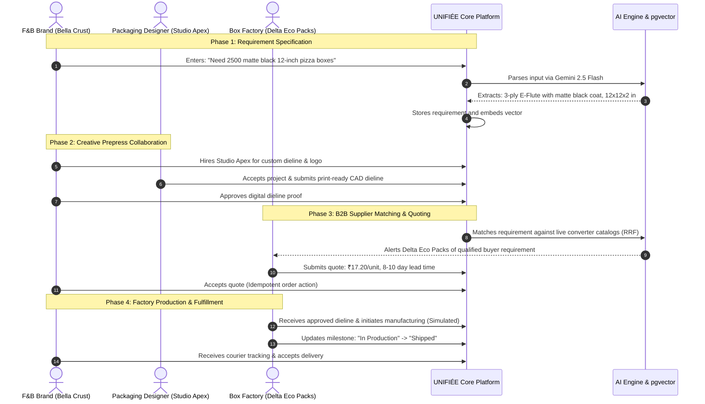
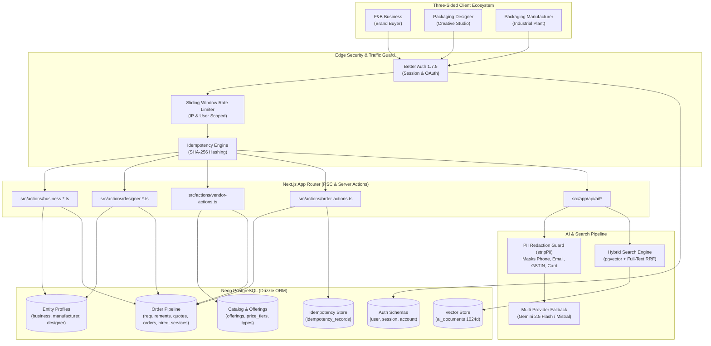
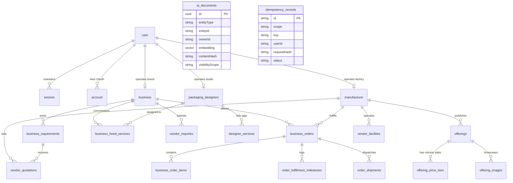
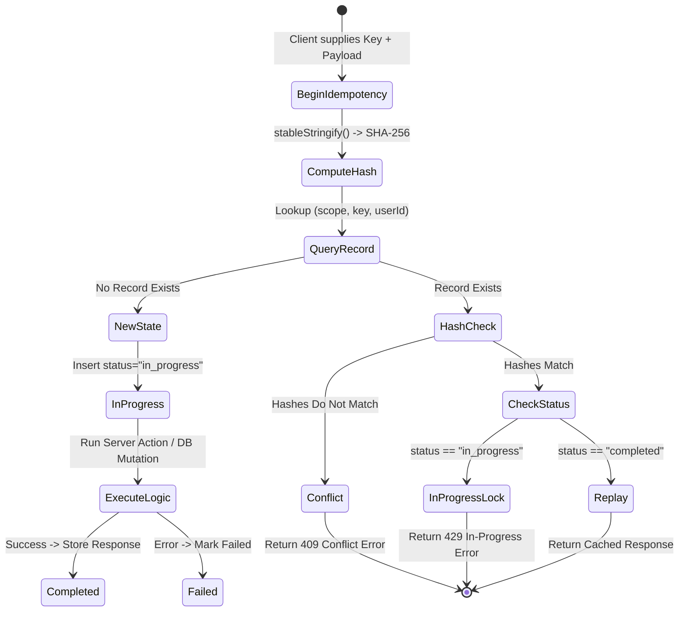
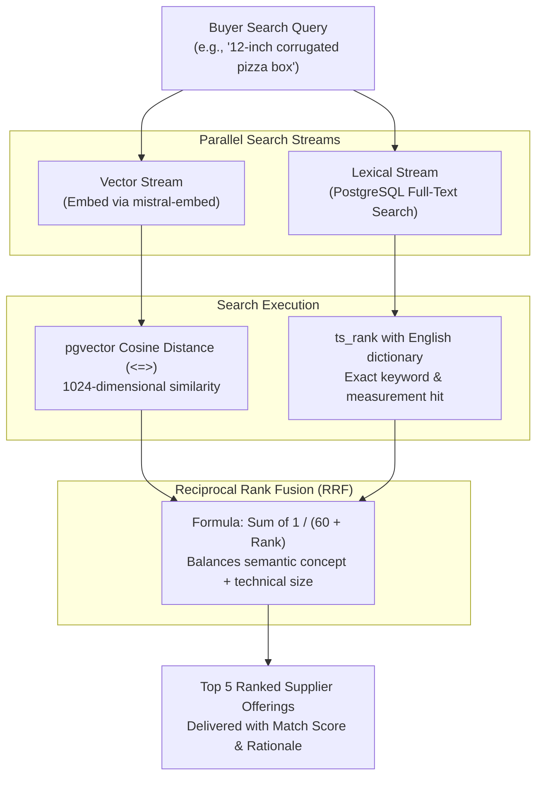

# UNIFIÉE — Comprehensive System Architecture & Engineering Documentation

## 1. Project Overview

### 1.1 Executive Summary & Conceptual Mental Model
**UNIFIÉE** is an end-to-end B2B operating platform engineered specifically for the Food and Beverage (F&B) packaging procurement lifecycle.

To understand UNIFIÉE without reading thousands of lines of code, think of it as a purpose-built industrial coordination engine:
- **Part Creative Studio Marketplace**: Similar to specialized design platforms, it connects F&B brands with freelance packaging and structural dieline designers.
- **Part B2B Manufacturing Exchange**: Similar to an industrial marketplace, it enables corrugated box converters, paper cup fabricators, and commercial printers to list live factory catalog lines with volume discount slabs.
- **Part Prepress & Production Workflow Hub**: Unlike generic marketplaces that stop when an introduction is made, UNIFIÉE manages the entire mechanical pipeline—from turning rough conversational requests into technical specs (such as paper grammage, flute type, and moisture barriers), to digital dieline proof signoffs, and live factory fulfillment milestone tracking.

### 1.2 The Three Stakeholders
The platform unites three distinct user personas, each operating inside a customized dashboard:
1. **F&B Businesses (Buyers)**: Independent cafés, multi-outlet restaurants, quick-service restaurants (QSRs), cloud kitchens, and bakeries seeking customized, food-safe packaging.
2. **Packaging Designers (Creators)**: Specialized structural packaging designers, prepress artists, and graphic studios delivering CAD dielines, label artwork, and 3D mockups.
3. **Packaging Manufacturers & Printers (Converters)**: Industrial converting plants, flexographic/offset packaging printers, corrugated carton factories, and paper cup fabricators.

### 1.3 The Core Problem Space in Plain English
Procuring custom packaging for food brands is notoriously error-prone, opaque, and slow:
- **The "Speaking Different Languages" Problem**: A café owner might say, *"I need a sturdy, premium brown takeaway box for burgers that doesn't get soggy."* An industrial packaging converter cannot quote on that statement. The converter needs mechanical specifications: *What dimensions in millimeters? What board grammage (e.g., 280 GSM vs. 350 GSM)? What flute profile (E-flute vs. B-flute)? What inner barrier coating (aqueous dispersion vs. PE liner) to resist hot steam and grease?*
- **The Prepress Artwork Failure**: Graphic designers often design beautiful logos in RGB color spaces without understanding factory die-cutting tolerances, bleed margins, or crease lines. When files are sent directly to converters, the printing plates fail or the boxes fold incorrectly, resulting in wasted production runs worth thousands of dollars.
- **The Minimum Order Quantity (MOQ) Wall**: Independent food outlets cannot meet the 50,000-unit minimum order quantities of tier-one manufacturers, while converters waste valuable sales hours answering small, unqualified inquiries.

### 1.4 How UNIFIÉE Solves This
1. **AI Packaging Engineer**: An in-app artificial intelligence assistant (powered by Google Gemini 2.5 Flash) extracts exact industrial specifications from rough buyer notes and automatically builds an engineering brief.
2. **Closed-Loop Dieline Collaboration**: The brand hires a vetted designer on the platform. The designer uploads the exact production dieline to the project workspace.
3. **Hybrid Intelligent Supplier Matching**: The technical specification is semantically matched with live factory catalogs using hybrid vector search (combining AI vector embeddings with exact keyword filters).
4. **Prepress Signoff & Factory Dispatch**: The brand approves the digital artwork proof directly on the platform. Once approved, the dieline and volume order are routed directly to the manufacturer's shop floor, where production milestones (printing, die-cutting, QA, dispatch) are tracked in real time.

TEAM INPUT NEEDED: Commercial traction numbers, target regional hubs for the Eureka competition pilot, and founding team background.

---

## 2. Technical Stack Breakdown

### 2.1 Plain-English Guide to the Tech Stack
For non-coders evaluating the architecture, here is what each layer does and why it was chosen:

| Layer | Technology & Version | Plain-English Role | Why It Matters for This Product |
| :--- | :--- | :--- | :--- |
| **User Interface Framework** | Next.js 16.3.5 (App Router) | Web application engine | Combines fast screen loading (Server Components) with instant updates when clicking buttons (Server Actions), eliminating sluggish page reloads. |
| **Programming Language** | TypeScript 5.x | Strict safety net | Prevents bugs before they reach users by enforcing strict data types across forms, database queries, and AI outputs. |
| **Design & Styling Engine** | Tailwind CSS v4 & PostCSS | Design layout system | Modern utility-first styling with zero runtime JavaScript overhead, optimized for mobile phones and factory screens. |
| **Interactive UI Primitives** | Radix UI & Base UI | Accessible interface blocks | Ensures accessible dialogs, dropdowns, and slide-out drawers that support keyboard navigation and screen readers. |
| **Animations & Icons** | Motion 13.3.0 & Lucide React | Visual polish and smooth movement | Powers smooth transitions between onboarding steps, modals, and status badges. |
| **Client Memory & Sync** | Zustand 5.0.15 | Browser-side workflow store | Remembers user actions and order workflow states locally so testing and simulations feel instantaneous. |
| **Server Cache & Refetching** | TanStack React Query 5.103.2 | Data freshener | Keeps marketplace listings and incoming quotes automatically synchronized in the background. |
| **Forms & Input Validation** | React Hook Form 7.88 & Zod 4.6.5 | Input inspector | Validates phone numbers, GSTIN tax IDs, dimensions, and prices on both the browser and server before saving to the database. |
| **Database Engine** | PostgreSQL on Neon | Secure cloud vault | Serverless relational database providing transaction ACID guarantees, connection pooling (`DATABASE_URL`), and unpooled DDL endpoints (`DATABASE_URL_UNPOOLED`). |
| **AI Vector Search Extension** | pgvector Extension | Semantic memory index | Enables the database to understand the "meaning" of packaging requests rather than just matching exact words. |
| **Database Connector (ORM)** | Drizzle ORM 1.0.0-rc.4 & Drizzle Kit | Database translator | Converts TypeScript code into high-speed SQL queries with compile-time type safety. |
| **Security & Authentication** | Better Auth 1.7.5 | Identity & session manager | Securely logs in users with passwords or Google OAuth, generates encrypted session cookies, and defends against brute-force attacks. |
| **AI Orchestration Framework** | Vercel AI SDK 7.0 (`ai: 7.0.152`) | AI bridge | Connects the application to modern LLMs with streaming text and guaranteed JSON output structures. |
| **Primary AI Reasoning Model** | Google Gemini 2.5 Flash (`@ai-sdk/google`) | Automated packaging consultant | Fast model that extracts structured industrial packaging parameters from rough buyer notes. |
| **Secondary Fallback Model** | Mistral Small (`@ai-sdk/mistral`) | Backup AI generator | Automated safety backup model that takes over if primary API quotas or rate limits are reached. |
| **Vector Embedding Model** | Mistral Embed (`mistral-embed`) | Semantic mathematical translator | Converts packaging listings and customer inquiries into 1024-dimensional mathematical vectors for search. |
| **File Storage Architecture** | HTTPS URL Pointers | Asset reference layer | In the prototype, artwork and dieline files live on external HTTPS URLs (Figma, Drive, portfolio links) stored in Postgres. S3/R2 presigned upload buckets are scheduled for production. |
| **Transactional Email** | Resend 6.29.0 | Notification courier | Sends automated email confirmations when quotes arrive or order statuses update. |
| **Package Manager** | npm (v10+) | Dependency manager | Standard deterministic dependency management via `package-lock.json`. |

---

## 3. System Architecture & The Three-Sided Closed Loop

### 3.1 Real-World Journey: "Bella Crust Pizza"
To understand how data travels through UNIFIÉE, consider the journey of an artisanal pizzeria named **"Bella Crust"**:
1. **Requirement Formulation**: Bella Crust inputs rough notes: *"Need 2500 matte black 12-inch pizza boxes"*. Gemini 2.5 Flash parses the prompt into: **3-ply E-Flute Corrugated Board with matte black flood-coat exterior printing and grease-resistant food liner**, 12x12x2 in dimensions, 2-color brand logo print.
2. **Creative Collaboration**: Bella Crust hires Studio Apex from the Designer Marketplace. Studio Apex drafts CAD dielines adhering to die-cutting tolerances and uploads print-ready vector files.
3. **Supplier Matching & Bidding**: The technical specification is matched against converter catalogs using hybrid search (pgvector + full-text RRF). Delta Eco Packs submits a binding quote of ₹17.20/box with an 8–10 day lead time.
4. **Artwork Signoff & Production Dispatch**: Bella Crust approves the digital artwork proof in the dashboard. The order status updates to "In Production". *(Note: In this prototype build, the hand-off to the factory floor is simulated through workflow store updates and fulfillment milestone tracking).*

> **Note on Prototype Test Personas**: The prototype database seeds test account personas ("Brewed Cafe" for the business, "John" for the manufacturer, "The Dark Knight" for the designer studio, while landing mockups showcase fictional brands like "Bluebird Café"). The narrative above uses "Bella Crust Pizzeria" and "Delta Eco Packs" as the canonical illustrative scenario to explain the end-to-end commercial workflow.



### 3.2 System Architecture Diagram


---

## 4. Database Schema & Data Model Teardown

### 4.1 Plain-English Database Guide
The database contains **26 distinct tables** grouped into four functional categories:
1. **Identity & Security**: Stores user logins, encrypted session cookies, and double-billing protection logs (`user`, `session`, `account`, `verification`, `idempotency_records`).
2. **Profiles & Portfolios**: Stores restaurant details, factory machinery capabilities, and designer portfolios (`business`, `manufacturer`, `vendor_facilities`, `packaging_designers`).
3. **Marketplace Catalog**: Stores standardized packaging types, factory products, and volume discount slabs (`offering_types`, `offerings`, `offering_price_tiers`, `offering_images`).
4. **Active Commerce & Collaboration**: Stores brand requirements, manufacturer bids, purchase orders, and shipment tracking milestones (`business_requirements`, `vendor_quotations`, `business_orders`, `business_order_items`, `business_hired_services`, `order_shipments`, `order_fulfillment_milestones`).

### 4.2 Entity-Relationship Diagram (ERD)


### 4.3 Key Schema Implementations
Below is the Drizzle ORM definition from `src/lib/db/schema/offering.ts` enforcing domain validation at the database level:
```typescript
// src/lib/db/schema/offering.ts
export const offeringsTable = pgTable("offerings", {
    id: uuid("id").primaryKey().notNull(),
    vendorId: uuid("vendor_id").notNull().references(() => manufacturerTable.id, { onDelete: "restrict" }),
    offeringType: varchar("offering_type", { length: 100 }).notNull(),
    title: varchar("title", { length: 240 }).notNull(),
    unitPrice: numeric("unit_price", { precision: 12, scale: 4 }).notNull(),
    minOrderQuantity: integer("min_order_quantity").notNull().default(1),
    leadTimeDaysMin: integer("lead_time_days_min").notNull(),
    leadTimeDaysMax: integer("lead_time_days_max").notNull(),
    validFrom: timestamp("valid_from").notNull().defaultNow(),
    validUntil: timestamp("valid_until").notNull(),
    status: offeringStatusEnum("status").notNull().default("draft"),
}, (table) => [
    check("offerings_unit_price_nonnegative_check", sql`${table.unitPrice} >= 0`),
    check("offerings_min_order_quantity_positive_check", sql`${table.minOrderQuantity} > 0`),
    check("offerings_lead_time_check", sql`${table.leadTimeDaysMin} >= 0 AND ${table.leadTimeDaysMax} >= ${table.leadTimeDaysMin}`),
    check("offerings_validity_window_check", sql`${table.validUntil} > ${table.validFrom}`),
])
```

---

## 5. Security, Idempotency & Rate Limiting Infrastructure

### 5.1 The Anti-Double-Billing Safeguard: Idempotency in Plain English
In physical B2B purchasing, an order can cost tens of thousands of rupees. If a restaurant manager taps "Confirm Order" on a poor Wi-Fi connection, waits 5 seconds, gets nervous, and taps "Confirm Order" again, a poorly engineered platform would create **two distinct manufacturing orders** and charge the company twice.

UNIFIÉE solves this using **Cryptographic Idempotency**:
1. When a user submits an order, the system inspects every detail (quantity, address, price, item IDs).
2. It sorts the information into a standardized order and computes a unique cryptographic fingerprint (an **SHA-256 hash**).
3. It checks the database table `idempotency_records`:
   - If this fingerprint has never been seen: The system locks the request (`status: "in_progress"`), processes the order, saves the result, and sets `status: "completed"`.
   - If the exact same request arrives while processing: The system detects the lock and politely asks the user to wait, preventing duplicate executions.
   - If the exact same request arrives after completion: The system **replays the saved response directly from the database without re-executing any database writes**.
   - If someone tries to reuse the same request ID with altered data: The system flags a `conflict` error and rejects the request.



### 5.2 Deterministic Key Sorting Code
```typescript
// src/lib/server/idempotency-core.ts
function stableStringify(value: unknown): string {
    if (value === null || typeof value !== "object") return JSON.stringify(value)
    if (Array.isArray(value)) return `[${value.map(stableStringify).join(",")}]`
    const record = value as Record<string, unknown>
    return `{${Object.keys(record).sort().map((key) => `${JSON.stringify(key)}:${stableStringify(record[key])}`).join(",")}}`
}

export function hashIdempotencyPayload(payload: unknown): string {
    return crypto.createHash("sha256").update(stableStringify(payload)).digest("hex")
}
```

### 5.3 Sliding-Window Rate Limiter
To prevent bot attacks and automated credential abuse, the platform uses an in-memory sliding-window rate limiter (`src/lib/server/rate-limit.ts`).

```typescript
// src/lib/server/rate-limit.ts
export function getClientIpFromHeaders(reqHeaders: Headers): string {
  const vercel = reqHeaders.get("x-vercel-forwarded-for");
  if (vercel) return vercel.split(",")[0]?.trim() || "";

  const cloudflare = reqHeaders.get("cf-connecting-ip");
  if (cloudflare) return cloudflare.trim();

  const realIp = reqHeaders.get("x-real-ip");
  if (realIp) return realIp.trim();

  const forwarded = reqHeaders.get("x-forwarded-for");
  if (forwarded) return forwarded.split(",")[0]?.trim() || "";

  return "127.0.0.1";
}
```

---

## 6. AI Architecture, Hybrid RAG & Privacy Controls

### 6.1 How the AI Thinks & Searches: Hybrid Search in Plain English
Why did UNIFIÉE build a custom **Hybrid Search** engine rather than relying on standard keyword search or pure vector AI search?

- **The Flaw of Standard Keyword Search**: If a café searches for *"biodegradable salad packaging"*, a keyword search will miss a supplier who titled their listing *"Compostable Sugarcane Bagasse Bowl 500ml"*, because none of the keywords match exactly.
- **The Flaw of Pure AI Vector Search**: Vector search understands meaning, but it struggles with numbers and measurements. If a user searches for an *"8 oz coffee cup"*, a pure vector search might return a *"12 oz coffee cup"* because the semantic representations of coffee cups are nearly identical in latent space.
- **The UNIFIÉE Hybrid Solution**: The platform uses **Reciprocal Rank Fusion (RRF)** to combine both methods:
  1. It performs a **vector search** using Mistral Embed (1024-dimensional vectors) in `pgvector` to identify conceptual matches.
  2. It performs a **PostgreSQL full-text search** (`to_tsvector` and `plainto_tsquery`) to boost exact measurements, sizes, and technical codes.
  3. It merges the two rankings using a mathematical formula so that items matching both meaning and measurements rise to the top.



### 6.2 The Reciprocal Rank Fusion Code
```typescript
// src/lib/ai/retrieval.ts
export async function searchHybrid({ query, session, filters, limit = 5 }) {
    const trimmed = query.trim();
    if (!trimmed) return [];
    assertRequirementAccess(session, filters?.entityType);

    const [queryVector, textResults] = await Promise.all([
        embedSingleQuery(trimmed),
        searchFullText({ query: trimmed, session, filters, limit }).catch(() => []),
    ]);

    let vectorResults = [];
    if (queryVector) {
        vectorResults = await searchVector({ queryVector, session, filters, limit }).catch(() => []);
    }

    if (vectorResults.length > 0 && textResults.length > 0) {
        return reciprocalRankFusion(vectorResults, textResults, limit);
    }
    return (vectorResults.length > 0 ? vectorResults : textResults).slice(0, limit);
}
```

### 6.3 Data Privacy: Automated PII Stripping
Before customer prompts are sent to external LLMs, personal contact details and Indian tax identifiers are automatically redacted by regex filters in `src/lib/ai/privacy.ts`:
```typescript
// src/lib/ai/privacy.ts
const EMAIL_REGEX = /[a-zA-Z0-9._%+-]+@[a-zA-Z0-9.-]+\.[a-zA-Z]{2,}/g;
const PHONE_REGEX = /(?:\+?\d{1,3}[-.\s]?)?\(?\d{3}\)?[-.\s]?\d{3}[-.\s]?\d{4}\b/g;
const GSTIN_REGEX = /\b[0-9]{2}[A-Z]{5}[0-9]{4}[A-Z]{1}[1-9A-Z]{1}Z[0-9A-Z]{1}\b/gi;
const CARD_REGEX = /\b(?:\d{4}[-\s]?){3}\d{1,4}\b/g;

export function stripPii(input: string | null | undefined): string {
    if (!input) return "";
    return input
        .replace(EMAIL_REGEX, "[REDACTED_EMAIL]")
        .replace(PHONE_REGEX, "[REDACTED_PHONE]")
        .replace(GSTIN_REGEX, "[REDACTED_GSTIN]")
        .replace(CARD_REGEX, "[REDACTED_CARD]")
        .trim();
}
```

---

## 7. Comprehensive Feature Breakdown

---

### 7.1 Authentication, Social Sign-In & Rate Limiting
- **Plain-English Comprehension**:
  Allows users to securely create an account or sign in using email or Google. If an OAuth user joins, the system ensures they configure a password so they are never locked out. Sliding-window IP rate limiting prevents automated account enumeration and email harvesting by limiting lookup attempts to 5 per minute per IP.
- **Technical Architecture**: The form (`src/components/site/login-form.tsx`) sends a request to `POST /api/auth/check-email`. The server applies rate limiting (`src/lib/server/rate-limit.ts`) and inspects `user` and `account` in `auth-schema.ts`. Credential validation is handled by Better Auth (`src/lib/auth.ts`).
- **Key code snippet**:
```typescript
// src/app/api/auth/check-email/route.ts
const rateCheck = await checkRateLimit(
  { keyPrefix: "check-email", limit: 5, windowSeconds: 60 },
  clientIp
);
if (!rateCheck.success) {
  return NextResponse.json(
    { status: "error", error: "Too many sign-in attempts. Please wait a minute." },
    { status: 429, headers: { "Retry-After": String(rateCheck.resetInSeconds) } }
  );
}
```

---

### 7.2 Multi-Role Onboarding & Pathway Routing
- **Plain-English Comprehension**:
  A three-step onboarding wizard that routes accounts into their dedicated portal (Business, Manufacturer, or Designer). It captures legal business credentials (such as GSTIN tax IDs) and validates them on the server.
- **Technical Architecture**: `src/components/site/onboarding-form.tsx` guides the user and invokes `registerBusinessAction`, `registerManufacturerAction`, or `registerDesignerAction` in `src/actions/`.
- **Key code snippet**:
```typescript
// src/actions/business-registration.ts
export async function registerBusinessAction(data: z.infer<typeof businessOnboardingSchema>) {
    const session = await auth.api.getSession({ headers: await headers() });
    if (!session?.user) return { success: false, error: "Must be signed in." };

    const rateCheck = await checkRateLimit({ keyPrefix: "business-reg", limit: 5, windowSeconds: 600 }, session.user.id);
    if (!rateCheck.success) return { success: false, error: "Too many attempts." };

    await db.insert(business).values({ id: crypto.randomUUID(), userId: session.user.id, ...data });
    return { success: true };
}
```

---

### 7.3 Business Dashboard & Prepress Artwork Proof Signoff
- **Plain-English Comprehension**:
  The brand manager's cockpit. They track active orders, compare incoming supplier bids, and inspect digital dieline artwork proofs. Production never starts until the brand owner clicks "Approve Proof", preventing misprinted packaging runs.
- **Technical Architecture**: Server Component (`src/app/business/page.tsx`) queries `business` profile and renders `dashboard-view.tsx` with Zustand workflow store hydration.
- **Key code snippet**:
```typescript
// src/components/business/dashboard-view.tsx
const handleApproveProof = () => {
    setProofApproved(true)
    setIsProofModalOpen(false)
    if (proofOrder) {
        updateOrderStatus(proofOrder.id, "In Production")
    }
    toast.success("Artwork proof approved. Production initiated.")
}
```

---

### 7.4 AI-Assisted Packaging Specification Extractor
- **Plain-English Comprehension**:
  Extracts specs from rough notes. A restaurant owner can type unstructured notes (e.g., *"Need 2500 burger boxes 6x6x3 inches that won't get soggy on delivery"*) and the AI extracts technical specifications (E-flute corrugated kraft, grease-resistant barrier, 6x6x3 in).
- **Technical Architecture**: Executes `POST /api/ai/requirements/extract` using Google Gemini 2.5 Flash and `Output.object({ schema: aiRequirementOutputSchema })`.
- **Key code snippet**:
```typescript
// src/app/api/ai/requirements/extract/route.ts
const result = await generateText({
    model: getModel("requirement_builder"),
    output: Output.object({ schema: aiRequirementOutputSchema }),
    system: buildRequirementBuilderSystemPrompt(),
    prompt: stripPii(parseResult.data.prompt),
    abortSignal: AbortSignal.timeout(15000),
});
```

---

### 7.5 Semantic Vendor Matcher via Hybrid RAG
- **Plain-English Comprehension**:
  Matches customer packaging requirements with factory product lines. It ranks suppliers by combining AI conceptual understanding with exact size and quantity relevance, boosting exact matches alongside semantic similarity.
- **Technical Architecture**: The route `src/app/api/ai/requirements/search-vendors/route.ts` runs vector search (`<=>`) and full-text search, fused via Reciprocal Rank Fusion.
- **Key code snippet**:
```typescript
// src/app/api/ai/requirements/search-vendors/route.ts
const context: SessionContext = { userId: session.user.id, role: "business", businessId: owner.id };
const vectorResults = await searchVector(queryDocument.embedding, context, parsed.data.limit * 2);
const textResults = await searchFullText(queryDocument.content, context, parsed.data.limit * 2);
const merged = reciprocalRankFusion(vectorResults, textResults).slice(0, parsed.data.limit);
```

---

### 7.6 Quotation Acceptance & Idempotent Purchase Orders
- **Plain-English Comprehension**:
  Allows brands to accept a manufacturer's quote with a single click. It automatically declines competing bids, creates a purchase order, and prevents accidental duplicate orders using SHA-256 fingerprinting.
- **Technical Architecture**: Server Action `createOrderFromQuoteAction` in `src/actions/order-actions.ts` runs `beginIdempotency()` with an SHA-256 hash before inserting into `business_orders`.
- **Key code snippet**:
```typescript
// src/actions/order-actions.ts
const profile = await getBusinessForSession()
if (!profile || profile.id !== parsed.data.businessId) return { success: false, error: "Unauthorized." };

const idempotency = idempotencyResponse(await beginIdempotency("create-order", parsed.data.idempotencyKey ?? crypto.randomUUID(), profile.id, parsed.data));
if (idempotency.handled) return idempotency.response as OrderActionResult<{ orderId: string; orderNumber: string; status: "confirmed" }>;
```

---

### 7.7 Packaging Designer Studio & Service Listings
- **Plain-English Comprehension**:
  The creative studio workspace where designers publish specialized dieline services, showcase portfolio artwork, and use an AI generator to draft professional service descriptions and deliverable checklists.
- **Technical Architecture**: Page `src/app/designer/page.tsx` retrieves designer metrics; `createDesignerService` publishes gigs with image URL validation.
- **Key code snippet**:
```typescript
// src/actions/designer-services.ts
export async function createDesignerService(formData: FormData): Promise<CreateDesignerServiceResult> {
    const session = await auth.api.getSession({ headers: await headers() })
    if (!session?.user) return { success: false, error: "Please sign in again." }

    const [designer] = await db.select({ id: packagingDesignerTable.id }).from(packagingDesignerTable).where(eq(packagingDesignerTable.userId, session.user.id)).limit(1)
    if (!designer) return { success: false, error: "Designer profile not found." }
```

---

### 7.8 Manufacturer Operations Hub & Offering Studio
- **Plain-English Comprehension**:
  The factory management center where converters publish packaging catalog lines with tiered volume pricing (e.g., ₹15/box for 1,000 units vs. ₹10/box for 10,000 units), review incoming orders, and track manufacturing milestones.
- **Technical Architecture**: Server Action `createOfferingAction` writes to `offerings` and `offering_price_tiers`; `updateOrderStatusAction` logs milestones.
- **Key code snippet**:
```typescript
// src/actions/vendor-actions.ts
export async function createOfferingAction(input: CreateOfferingInput) {
    const vendor = await getAuthenticatedVendor()
    if (!vendor) return { success: false, error: "Unauthorized." }

    const offeringId = crypto.randomUUID()
    await db.insert(offeringsTable).values({ id: offeringId, vendorId: vendor.manufacturerId, ...input, createdBy: vendor.userId })
    return { success: true }
}
```

---

### 7.9 Context-Aware Floating AI Assistant
- **Plain-English Comprehension**:
  A 24/7 packaging consultant accessible in the corner of every screen. Users can ask technical questions (e.g., *"What GSM should I use for a hot coffee sleeve?"*) or request navigation help without leaving their dashboard.
- **Technical Architecture**: Component `src/components/ai/assistant-panel.tsx` streams responses from `POST /api/ai/assistant` using Vercel AI SDK `toTextStreamResponse`.
- **Key code snippet**:
```typescript
// src/app/api/ai/assistant/route.ts
const result = streamText({
    model: getModel("assistant_chat"),
    system: buildAssistantSystemPrompt(role, userContext, knowledgeContext),
    messages: cleanMessages,
});

return result.toTextStreamResponse({
    headers: responseHeaders,
});
```

---

## 8. Build, Environment & Evaluator Demo Walkthrough

### 8.1 Prerequisites & Installation
- **Node.js 20.x or higher**, npm 10.x+, and a PostgreSQL 15+ database with the `pgvector` extension enabled.
- Clone repository and run `npm install`.

### 8.2 Required Environment Variables (`.env.local`)
Create a `.env.local` file containing the following keys:
- `DATABASE_URL`: Pooled PostgreSQL connection string (Neon pooler) used for all application queries.
- `DATABASE_URL_UNPOOLED`: Direct PostgreSQL connection string used for schema migrations with `drizzle-kit`.
- `BETTER_AUTH_SECRET`: 32-character secret key used to sign and encrypt session cookies.
- `BETTER_AUTH_URL`: Canonical root URL of the application (e.g., `http://localhost:3000`).
- `NEXT_PUBLIC_BASE_URL`: Public base URL used for client redirects and canonical links.
- `GOOGLE_CLIENT_ID` / `GOOGLE_CLIENT_SECRET`: Google OAuth 2.0 credentials for social sign-in.
- `GEMINI_API_KEY`: Google Generative AI key for Gemini 2.5 Flash spec extraction and conversational assistant.
- `MISTRAL_API_KEY`: Mistral AI key for `mistral-embed` vector generation and secondary model failover.

### 8.3 Evaluator Demo Script: Step-by-Step Testing
To test the end-to-end prototype workflow as an evaluator:
1. **Start Server**: Run `npm run dev` and open `http://localhost:3000`.
2. **Onboarding Experience**: Click "Get Started" -> Select "I'm an F&B Business" -> Fill out the brand details form to enter the Business Portal.
3. **Test AI Spec Extractor**: Navigate to `/business/requirements/new`. Click the "Pizza Boxes" prompt preset. Click "Extract Specs with AI". Observe Gemini 2.5 Flash parse dimensions, GSM, and flute profiles into structured fields.
4. **Test Proof Approval**: Return to `/business`. On the active order card, click "Review proof". Inspect the digital dieline dialog and click "Approve Proof & Start Print" to see the order transition to "In Production".
5. **Test Designer & Factory Dashboards**: Visit `/designer` to view the creative studio, and `/manufacturer` to view the plant operations center.

---

## 9. Prototype Limitations & Simulated Features

In accordance with competition transparency guidelines, the following items represent prototype boundaries in the current MVP build:

1. **Payment & Escrow UI is a Visual Placeholder**: The escrow settlement badges (*"Instant Escrow Settlement Enabled"*, *"In Escrow"*, *"Settled & Paid"*) and monetary balances shown in screenshots are front-end design mockups demonstrating the intended user experience. Live payment gateways (Razorpay/Stripe) and banking disbursements are not connected.
2. **Factory Handoff is Simulated**: Clicking "Approve Proof" updates the prototype's client/server workflow store to "In Production". Direct digital dispatch to automated factory prepress ERP machinery is simulated.
3. **Artwork Storage Uses External URLs**: Dielines and portfolio images currently store external HTTPS URLs (Figma, Google Drive, portfolio links) in PostgreSQL. Dedicated cloud blob storage (AWS S3 / Cloudflare R2) with presigned direct uploads is scheduled for Phase 2.
4. **Logistics Tracking Uses Milestone Triggers**: Shipping milestones are updated via supplier dashboard actions rather than live carrier webhooks (Delhivery, Blue Dart).
5. **Demo Persona Names**: The database contains initial seed personas ("Brewed Cafe", "John", "The Dark Knight"). The narrative in this document uses "Bella Crust Pizzeria" and "Delta Eco Packs" as an illustrative scenario.
